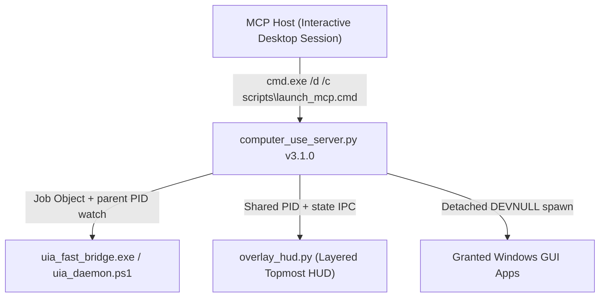

# Windows Computer Use architecture (`v3.1.0`)

This document explains how Windows Computer Use operates under the hood on Windows 10 (build 19041 or newer) and Windows 11. The server is built directly on Win32 `ctypes` and Windows UI Automation so it runs fast and stays portable across any user machine.

---

## 1. Process topology and lifecycle

### Interactive desktop transport
The MCP host spawns `scripts\launch_mcp.cmd` inside the active Windows desktop session (`WinSta0\Default`) so the server can read real application windows and send hardware input. The launcher resolves a working Python 3.10 or newer interpreter and skips broken Microsoft Store stubs then installs `pillow` and `numpy` into the local runtime folder (`pylibs_cp*`) if missing and falls back to `%LOCALAPPDATA%\computer-use-win32` when the plugin directory is read only.

### Orphan proof shutdown and artifact purge
Every persistent UI Automation bridge process is assigned to a Win32 Job Object configured with `JOB_OBJECT_LIMIT_KILL_ON_JOB_CLOSE` and also watches its parent server PID directly. A background watchdog thread inside `computer_use_server.py` monitors the parent and grandparent host process handles via `OpenProcess(SYNCHRONIZE)` so if the MCP client crashes or restarts the server exits immediately and restores system cursors and closes all helpers.

When `cu_launch_app` starts a desktop app it always redirects `stdin` and `stdout` and `stderr` to `DEVNULL` with detached process flags. Even if an application prints console output on startup it can never corrupt the MCP JSON RPC `stdout` stream.

Screenshots and observation artifacts stay inside the local runtime folder and are purged automatically when `cu_revoke_app({"all": true})` runs or when the MCP server exits cleanly.

---

## 2. Core technical subsystems

### 2.1 Per monitor DPI v2 everywhere
Windows UI Automation and GDI report mixed logical and physical rectangles whenever a helper process starts without DPI awareness. In `v3.1.0` every process initializes Per Monitor DPI v2 with a Windows 10 `SetProcessDpiAwareness(2)` fallback before loading UI libraries:
- `computer_use_server.py` initializes DPI awareness on module import.
- `uia_fast_bridge.cs` and `uia_daemon.ps1` initialize DPI awareness before referencing `UIAutomationClient` or `WindowsBase`.
- `overlay_hud.py` queries `EnumDisplayMonitors` and `GetDpiForMonitor` per monitor so the border glow and top pill follow the active display at the right scale factor even with negative multi monitor coordinates.

### 2.2 Modal immunity and popup aware capture and password protection
Cross process Win32 calls can block when an owner window disables itself behind a modal dialog. Capture and UI inspection stay responsive and safe in five ways:
1. `PrintWindow(PW_RENDERFULLCONTENT)` runs inside a dedicated worker thread that owns its entire GDI device context and DIB section lifecycle so a timeout never frees GDI handles out from under a running call. Modal disabled windows use a tight 0.45 second limit before falling back to a clipped GDI `BitBlt` screen capture.
2. `_detect_active_popup` checks `GW_ENABLEDPOPUP` and `GUITHREADINFO.hwndMenuOwner` and same PID foreground popups. When a context menu or dropdown is open `cu_observe` captures the composited screen region and inspects the popup UI tree so the menu behind the main window is never missed.
3. `cu_click` checks whether the target point hits a same PID popup before calling `SetForegroundWindow` on the owner window so clicking an item inside a right click menu does not dismiss the menu first.
4. `cu_zoom` requires either a granted `hwnd` (or window bound `observation_id`) or explicit `allow_full_desktop=true` so desktop wide cropping cannot happen without permission.
5. `uia_fast_bridge.cs` compiles on first run via built in Windows `.NET Framework 4.x` `csc.exe` into `uia_fast_bridge.exe` and is verified by `SHA-256` before execution with automatic fallback to `uia_daemon.ps1`. Both UI Automation bridges replace cross process `AutomationElement.FocusedElement` queries with cached `HasKeyboardFocusProperty` reads and check cached `IsPasswordProperty` so password field values are redacted before data reaches Python and cap traversal at 1500 nodes and 1100 milliseconds.

### 2.3 Hardware input and framework compatibility
Pointer paths and curves use `SendInput` with pixel center virtual desktop math (`((x - left) + 0.5) * 65536 / width`) at 120Hz rather than `SetCursorPos` so ink canvases and custom viewports receive smooth sample streams. Keyboard shortcuts resolve virtual keys and shift masks against the target window thread layout via `GetKeyboardLayout` and `VkKeyScanExW` and `MapVirtualKeyExW`.

`cu_set_value` first attempts UI Automation `ValuePattern` and falls back to foreground click and select all and Unicode `SendInput` for modern frameworks such as Electron and Chromium and WinUI3 and Qt and Java and also keeps direct background message dispatch for classic Win32 `Edit` controls and off desktop test harnesses.

### 2.4 GUI first app resolution
`cu_launch_app` checks explicit `.exe` paths and dynamic Registry `App Paths` and `Uninstall` entries and `WindowsApps` and Squirrel install folders and Start Menu `Get-StartApps` before falling back to `PATH`. It inspects the two byte PE `OptionalHeader.Subsystem` field (`2` for GUI versus `3` for console) so GUI desktop apps beat same name command line tools and skips UNC network shares that could stall on offline drives.

### 2.5 Dual file HUD coordination and three stage status pill
`overlay_state.json` has `computer_use_server.py` as its sole writer while `overlay_pid.json` has two clear writer roles across the lifecycle:
- Right after spawning `overlay_hud.py` the server writes an initial spawn record (`pid` and `status: "running"` and `startedAt`) to `overlay_pid.json`.
- Once the HUD daemon initializes its layered windows it writes its full `running` record (including `hwnd` and `pillHwnd` and `rippleHwnd` and `parentPid`) to `overlay_pid.json`. Before playing its exit fade out it restores OS cursors and writes the `exiting` record (with `reason` and `stoppedAt`) to `overlay_pid.json` and releases its named mutex so a new tool call never races a fading instance.

To keep the overlay calm and predictable across fast batches and slow model turns:
- `_format_pill_caption` strips raw executable names and window handles and internal action strings so Stage 1 shows `Antigravity is using your computer` or clean stage labels such as `3/5 Opening desktop app` while a tool runs and for `1.6` seconds afterward.
- Stage 2 switches after `1.6` seconds of idle time to `Antigravity • Thinking...` for up to `CUA_THINKING_WAIT_SEC` (default `90` seconds).
- Stage 3 switches after `90` seconds to `Antigravity • Waiting for model...` up to `CUA_HUD_IDLE_TIMEOUT_SEC` (default `600` seconds) so long reasoning pauses never close the pill prematurely.
- The top pill shimmer always renders 28 frames on a fixed 2.15 second wall clock cycle (`PILL_SHIMMER_CYCLE_SEC = 2.15`) and updates captions asynchronously on a worker thread so animation speed never changes with action throughput.
- Physical `Esc` is polled continuously (`GetAsyncKeyState(VK_ESCAPE)`). When pressed the HUD daemon restores normal cursors through `SPI_SETCURSORS` and writes `reason: "esc"` to `overlay_pid.json` and the server watchdog revokes every active grant immediately. On the model's next call `check_emergency_stop` raises `user_closed_computer_use` once so the agent stops cleanly and subsequent `cu_launch_app` or `cu_grant_app` calls start a fresh session cleanly. Optional physical mouse takeover during idle is off by default (`CUA_HUD_HUMAN_TAKEOVER=0`).

### 2.6 Fast local element matching (`scripts/local_matcher.py`)
`match_ui_element` resolves plain language element targets from the UI Automation tree in under one millisecond without extra screenshots. It combines Unicode NFKD normalization with CJK character splitting and `camelCase` or `snake_case` tokenization and suffix stemming and Jaro Winkler similarity and CSS3 color distance and control role weighting.

Optional Tier 2 LLM fallback is opt in through `CUA_MATCHER_ENDPOINT` or `CUA_MATCHER_AUTO_DISCOVER=1` which probes only dedicated local inference ports (`11434` and `1234` and `1337`). Non loopback URLs passed in `CUA_MATCHER_ENDPOINT` are rejected automatically unless `CUA_ALLOW_REMOTE_MATCHER=1` is explicitly set.

---

## 3. Six layer safety model

1. Expiring session grants require every inspected or controlled app to be granted explicitly through `cu_grant_app` or `cu_launch_app` and expire unused grants after `CUA_GRANT_TTL_SEC` (default `600` seconds) while `cu_zoom` requires a granted window or `allow_full_desktop=true`.
2. Mandatory deny lists block terminals and shells and password managers and UAC or admin tools and AI agent hosts across normalized process names and UWP Start Menu app IDs and launch arguments (such as passing `cmd.exe` to `explorer.exe`) along with `Win` key chords and `ctrl+shift+esc` and `ctrl+esc`.
3. Read only browser defaults keep web browsers in `look_only` mode unless the user authorizes interactive browser input.
4. Sensitive editor title checks block keyboard input when an editor window title matches shell profiles or SSH keys or `.git/hooks` or MCP configs or executable script extensions such as `.ps1` and `.bat` and `.cmd` but allow ordinary source files like `.js` or `.py`.
5. Environment and focus checks verify the desktop is unlocked and block elevated UIPI targets and reject occluded clicks or scrolled points and abort typing if foreground focus changes mid stream.
6. Physical emergency stops poll `VK_ESCAPE` continuously (`user_closed_computer_use`) and monitor the upper left `(0, 0)` corner of every attached display (`emergency_stop`) and immediately restore cursors and revoke all active grants.
