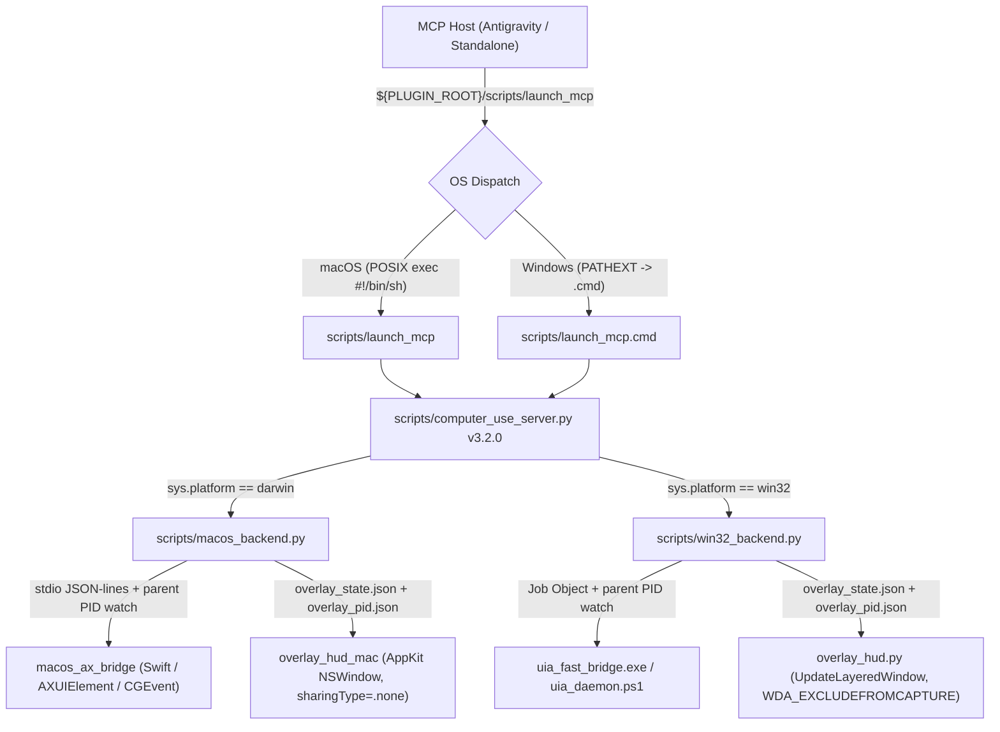

# Computer Use Architecture (`v3.2.0`)

This document explains how Antigravity Computer Use operates natively on **both macOS (`darwin`) and Windows 10/11 (`win32`)** from a single unified plugin package with zero third-party OS wrappers (`requirements.txt` stays strictly `pillow` and `numpy`).

---

## 1. Cross-platform launcher & process topology

### Extensionless cross-platform `mcp_config.json`
`mcp_config.json` sets `"command": "${PLUGIN_ROOT}/scripts/launch_mcp"` with no file extension:
- On **macOS**, the host executes `scripts/launch_mcp` (`#!/bin/sh`, `LF`, `0755`) directly. It discovers Python 3.9+ (including stock Apple Command Line Tools `/usr/bin/python3` 3.9.6 or Homebrew Python 3.12+), installs `pillow` and `numpy` via `pip install --target "$RUNTIME_ROOT/pylibs_cp<XY>"` (avoiding PEP 668 externally-managed errors), and `exec`s `computer_use_server.py`.
- On **Windows**, Go `os/exec.LookPath` searches `PATHEXT` (`.COM;.EXE;.BAT;.CMD`) and resolves `scripts/launch_mcp` directly to `scripts\launch_mcp.cmd` (`CRLF`), leaving the Windows launcher untouched.

### Orphan-proof shutdown and artifact purge
- **macOS**: The lifecycle watchdog records `initial_ppid = os.getppid()` and exits cleanly if `os.getppid() == 1` or `os.kill(ppid, 0)` raises `ProcessLookupError`. Both `macos_ax_bridge` and `overlay_hud_mac` also monitor their parent server PID independently and exit if orphaned.
- **Windows**: UIA helpers are attached to a Win32 Job Object (`JOB_OBJECT_LIMIT_KILL_ON_JOB_CLOSE`), and the watchdog monitors parent/grandparent handles via `CreateToolhelp32Snapshot` + `OpenProcess(SYNCHRONIZE)`.
- Detached app launches always redirect `stdin`/`stdout`/`stderr` to `DEVNULL` (`start_new_session=True` on macOS, `DETACHED_PROCESS` on Windows) so launched apps can never corrupt the MCP JSON-RPC `stdout` pipe.
- Session screenshots and observations are purged automatically on `cu_revoke_app({"all": true})` and on server exit.

---

## 2. Core technical subsystems

### 2.1 Retina logical points (macOS) & Per-Monitor DPI v2 (Windows)
- **macOS**: `CGWindowBounds`, `AXUIElement`, and `CGEvent` operate in **1x logical Quartz points**, while `/usr/sbin/screencapture -x -o -l <CGWindowID>` saves shadow-free **2x Retina backing pixels**. Every observation stores `originX`/`originY` in logical points and computes `scaleX = logical_width / returned_width`, `scaleY = logical_height / returned_height`, so observation pixel clicks, Set-of-Mark overlays, and `cu_zoom` map accurately across 1x and 2x displays.
- **Windows**: `win32_backend.py`, `uia_fast_bridge.cs`, `uia_daemon.ps1`, and `overlay_hud.py` initialize Per-Monitor DPI v2 before loading UI libraries so coordinates stay exact across mixed-DPI multi-monitor setups.

### 2.2 Accessibility & popup-aware capture
- **macOS (`scripts/macos_ax_bridge.swift`)**: Compiled once on first run via `xcrun swiftc -O` into `$CUA_RUNTIME_DIR/bin/macos_ax_bridge` and verified by `SHA-256` before launch (with JXA `osascript` fallback if CLT is absent). Walks `AXUIElement` trees with a `0.35s` messaging timeout, enables `AXEnhancedUserInterface` lazily for Chromium/Electron apps, redacts `AXSecureTextField` values before data leaves Swift, and maps `AXRole`/`AXSubrole` to canonical `local_matcher.py` roles (`Button`, `Edit`, `ComboBox`, `CheckBox`, `RadioButton`, `MenuItem`, `TabItem`, `Hyperlink`, `Slider`, `Text`). Context menus, `NSPopUpButton` dropdowns, and sheets share the owner's `kCGWindowOwnerPID` and are hit-tested and clicked without re-activating the main window.
- **Windows (`scripts/uia_fast_bridge.cs` / `uia_daemon.ps1`)**: Compiled via `.NET Framework 4.x` `csc.exe` with `SHA-256` verification, `IsPasswordProperty` redaction, `PrintWindow` worker thread isolation for modal-disabled windows, and same-PID popup preservation.

### 2.3 120Hz hardware input
- **macOS**: `macos_ax_bridge` posts 120Hz minimum-jerk `CGEvent` mouse glides (`.mouseMoved`), button clicks with proper `mouseEventClickState` for double/triple clicks, continuous 120Hz drags (`.leftMouseDragged`/`.rightMouseDragged`/`.otherMouseDragged` with `defer` mouse-up safety), line scroll events, Unicode keyboard typing (`CGEventKeyboardSetUnicodeString`), and modifier chords (`Cmd`, `Shift`, `Option`, `Control`).
- **Windows**: `win32_backend.py` dispatches 120Hz pixel-center `SendInput` pointer curves, HKL-aware hotkeys (`GetKeyboardLayout`/`VkKeyScanExW`), and batched UTF-16 `KEYEVENTF_UNICODE` typing.

### 2.4 Dual-file HUD coordination & three-stage status pill
Both `overlay_hud_mac.swift` (macOS AppKit `NSWindow` with `sharingType = .none`, `ignoresMouseEvents = true`) and `overlay_hud.py` (Windows `UpdateLayeredWindow` with `WDA_EXCLUDEFROMCAPTURE`) share the exact same IPC contract in `$CUA_RUNTIME_DIR`:
- `overlay_state.json` (written atomically by `computer_use_server.py`) carries `active`, `label`, `executing`, `lastToolDoneAt`, `thinkingWaitSec` (`90s`), `idleTimeoutSec` (`600s`), `allowCapture`, `parentPid`, `cursor`, and `click`.
- `overlay_pid.json` (written atomically by the HUD daemon) reports `status: "running"` while active and `status: "exiting"` with `reason: "esc"` or `"idle_timeout"` on exit.
- Official 4-color Antigravity brand mark is extracted from `/Applications/Antigravity.app/Contents/Resources/app.asar` (macOS) or `%LOCALAPPDATA%\Programs\antigravity\resources\app.asar` (Windows) via `scripts/antigravity_brand.py`.
- On macOS, physical `Esc` (`keyCode == 53`) is caught via **both** `NSEvent.addGlobalMonitorForEvents(matching: .keyDown)` and 60Hz `CGEventSource.keyState(.combinedSessionState, key: 53)` polling so `Esc` never misses during drags or menu tracking.

### 2.5 Fast local element matching (`scripts/local_matcher.py`)
Pure Python stdlib Tier 1 matcher (`<1ms`, up to 120 controls) with Unicode NFKD + CJK tokenization, `camelCase`/`snake_case` splitting, Jaro-Winkler + 3-gram Dice, W3C CSS3 perceptual color proximity, compound `->` / arithmetic goal decomposition, and opt-in loopback-only Tier 2 LLM fallback.

---

## 3. Six-layer safety model

1. Expiring per-app session grants (`CUA_GRANT_TTL_SEC=600`) and window-scoped `cu_zoom`.
2. Mandatory cross-platform deny lists for terminals, shells, password managers, OS auth/TCC/UAC prompts, macOS `System Settings` security panes, admin tools, AI agent hosts, and system chords.
3. Read-only (`look_only`) default for web browsers unless `allow_browser_input=true`.
4. Sensitive editor title guard for shell profiles, SSH keys, `.env`, `.git/hooks`, MCP configs, and executable scripts (`.sh`, `.zsh`, `.ps1`, `.bat`, `.cmd`), plus native password field redaction.
5. Unlocked-desktop, standard-user privilege, point-occlusion, and foreground-focus collision guards.
6. Physical `Esc` instant cancel (`user_closed_computer_use`) and monitor upper-left `(0, 0)` corner failsafe (`emergency_stop`).
